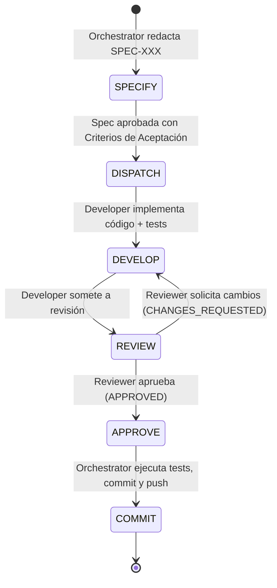

# 🤖 AGENTS.md — Protocolo de Desarrollo Multiagente y SDD Dinámico

Este documento define las especificaciones agénticas, la arquitectura de colaboración y el flujo de trabajo operativo para el desarrollo de **AI Agent Office** (`ai-agent-office`).

---

## 1. Principios Fundamentales del Proyecto

1. **Zero API Cost ($0):**
   * El sistema funciona bajo el **Patrón Observador Pasivo**.
   * No se consumen tokens de API de pago para la visualización. La ingesta de datos se realiza monitoreando logs y streams locales (`transcript.jsonl` de Antigravity, logs de Claude Code CLI, `office-events.jsonl` locales).
2. **Desarrollo Guiado por Especificaciones (Dynamic SDD):**
   * Ningún agente escribe código de producción sin una especificación técnica viva previa (`SPEC`).
   * La especificación evoluciona dinámicamente con los descubrimientos técnicos, pero siempre precede a la implementación.
3. **Flujo de Calidad Cycle-Loop:**
   * La implementación no se da por concluida hasta que el rol **Reviewer** audita y aprueba formalmente el entregable contra los criterios de aceptación.
4. **Git y Commits:**
   * Todos los mensajes de commit deben redactarse en **español** siguiendo el estándar Conventional Commits (`feat:`, `fix:`, `docs:`, `refactor:`, `test:`, `chore:`).
   * **Estrictamente prohibido incluir líneas o firmas de `Co-authored-by` en los commits.**
   * Las dudas o cambios arquitectónicos deben consultarse proactivamente con el usuario antes de proceder.

---

## 2. Roles del Equipo Multiagente

```mermaid
flowchart LR
    O["👑 Orchestrator<br/>(Coordinación, Specs & Git)"]
    D["💻 Developer<br/>(Implementación & Tests)"]
    R["🔍 Reviewer<br/>(Auditoría & QA)"]

    O -->|1. Asigna Spec & Tarea| D
    D -->|2. Envía Código & Tests| R
    R -->|3a. Feedback / Cambios| D
    R -->|3b. Aprobación (LGTM)| O
    O -->|4. Commit en Español & Push| O
```

### 👑 Orchestrator (Orquestador / Líder Técnico)
* **Responsabilidades:**
  * Define la hoja de ruta (Roadmap), desglosa hitos y redacta las especificaciones dinámicas (`docs/specs/SPEC-XXX.md`).
  * Asigna paquetes de trabajo atómicos al **Developer**.
  * Supervisa el cumplimiento de los principios del proyecto y la integridad arquitectónica.
  * Resuelve dudas con el usuario antes de tomar decisiones de diseño ambiguas.
  * Realiza la integración final, ejecución de commits en español y `git push`.

### 💻 Developer (Desarrollador / Constructor)
* **Responsabilidades:**
  * Implementa las soluciones técnicas estrictamente según la especificación activa.
  * Escribe código modular, tipado (TypeScript) y documentado.
  * Escribe pruebas unitarias e instrumentación técnica para verificar su código.
  * Al completar un bloque de trabajo, elabora un reporte de cambios y lo entrega al **Reviewer**.
  * Aplica las correcciones y el refactor solicitado por el **Reviewer** en caso de rechazo.

### 🔍 Reviewer (Auditor / Revisor de Calidad & QA)
* **Responsabilidades:**
  * Audita el código entregado por el **Developer** contra los criterios de aceptación de la `SPEC`.
  * Ejecuta los tests automatizados, verifica la compilación (`tsc`, linters) y la ausencia de errores en tiempo de ejecución.
  * Comprueba que se mantengan los principios (\$0 costo de API, rendimiento en Canvas/Phaser, código limpio).
  * Emite un veredicto formal estructurado:
    * **APPROVED (LGTM):** Código listo para integración por el Orchestrator.
    * **CHANGES_REQUESTED:** Detalla los hallazgos con archivo, línea, problema y recomendación exacta.

---

## 3. Protocolo SDD Dinámico (Spec-Driven Development)

Cada funcionalidad o hito del proyecto transita por las siguientes etapas:



### Estructura Estándar de una Especificación (`SPEC`)
Toda especificación debe contener:
1. **Identificador & Título:** `SPEC-XXX: Nombre de la funcionalidad`.
2. **Objetivo:** Qué problema resuelve y alcance exacto.
3. **Contratos de Datos / Interfaces:** Tipos TypeScript, esquemas JSON o eventos.
4. **Criterios de Aceptación (Acceptance Criteria):** Lista verificable tipo checklist.
5. **Estrategia de Pruebas:** Cómo se demostrará que funciona (tests unitarios, mocks, etc.).

---

## 4. Estructura del Cycle-Loop Multiagente

El ciclo de retroalimentación se rige por las siguientes reglas de iteración:

1. **Iteración Máxima por Tarea:**
   * Un ciclo `Developer <-> Reviewer` admite un máximo de **3 iteraciones**. Si a la 3ª iteración persiste el bloqueo, el Orchestrator interviene para simplificar la spec o consultar al usuario.
2. **Formato de Entrega de Developer:**
   * Archivos modificados/creados.
   * Resumen de la solución.
   * Comando de verificación ejecutado y su resultado (ej. `npm test`, `npx tsc`).
3. **Formato de Auditoría de Reviewer:**
   * **Estado:** `[APPROVED]` o `[CHANGES_REQUESTED]`.
   * **Checklist de Criterios de Aceptación:** Estado de cada ítem de la `SPEC`.
   * **Observaciones Técnicas:** Performance, seguridad, tipos TypeScript, arquitectura.
   * **Acciones Requeridas:** Pasos concretos para el Developer si hubo rechazo.

---

## 5. Reglas de Git y Flujo de Trabajo

1. **Mensajes de Commit:**
   * Siempre en **español**.
   * Formato: `<tipo>(<ámbito opcional>): <descripción corta en imperativo>`
   * Ejemplos:
     * `feat(server): implementar watcher chokidar para transcript.jsonl`
     * `fix(client): corregir parpadeo de sprite en estado typing`
     * `docs: actualizar AGENTS.md con protocolo de revisión`
     * `test(parser): agregar pruebas unitarias para eventos de antigravity`
2. **Firmas de Autoría:**
   * **NO incluir `Co-authored-by: ...` ni firmas automatizadas en ningún commit.**
3. **Sincronización:**
   * Tras la aprobación de un ciclo y creación de commit, ejecutar `git push origin <rama>`.

---

## 6. Stack y Convenciones de Código

* **Runtime:** Node.js (v18+)
* **Lenguaje:** TypeScript estricto (`strict: true`)
* **Cliente:** Phaser.js 3 + Vite + TailwindCSS
* **Servidor Daemon:** Express / Node.js + Chokidar + Socket.io + yaml
* **Configuración Central:** [`office.config.yaml`](./office.config.yaml)
* **Testing:** Vitest o Jest para pruebas unitarias de parsers y modelos de datos.
