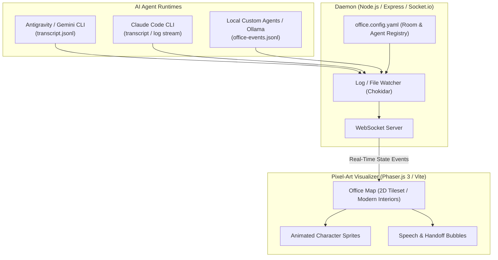

# 🏢 AI Agent Office

A lightweight, real-time 2D pixel-art visualizer that turns your multi-agent AI workflows into an animated virtual office. Watch your agents think, type at their desks, and walk over to collaborate with other agents.

---

## 🎯 Overview

Modern AI development often involves multiple agents communicating in parallel or sequentially (architects, developers, reviewers, QAs). Following terminal logs or raw JSON transcripts can be tedious and disconnected.

**AI Agent Office** acts as a visual, interactive observation deck:
- Each agent gets a designated room, office, or desk.
- Real-time visual status cues: **Thinking**, **Working / Typing**, **Idle**, or **Collaborating**.
- Speech bubbles and message flows when agents hand off tasks or communicate.
- Completely vendor-agnostic: Works with Claude (via Claude Code), Gemini, OpenAI, or local models.
- **Zero API Overhead:** Reads local transcripts, files, or event streams—no per-token API cost for visualization.

---

## 🏗️ Architecture



---

## ✨ Features

- **🎮 2D Pixel-Art Virtual Office:** Built with Phaser.js 3 and TypeScript, rendering top-down offices with modular rooms, desks, meeting areas, and animated sprites.
- **💰 Zero API Cost (Passive Observer Pattern):** Hooks into your local developer environment by monitoring log files or event pipes without making external API requests.
- **🔄 Multi-Model & Multi-Vendor:** Supports agents powered by Anthropic (Claude 3.7 Sonnet / Opus), Google (Gemini 2.5 Flash / Pro), OpenAI, or local models (Ollama).
- **⚙️ Declarative Office Configuration (`office.config.yaml`):** Configure rooms, desk coordinates, agent metadata, avatars, and file-watching paths without modifying code.
- **⚡ Real-Time Streaming:** Low-latency event streaming via WebSockets.

---

## ⚙️ Configuration Example (`office.config.yaml`)

```yaml
offices:
  - id: "architecture_room"
    name: "Architecture Studio"
    desk_coords: { x: 4, y: 3 }
    assigned_agent: "architect"
  - id: "dev_lab"
    name: "Engineering Lab"
    desk_coords: { x: 10, y: 3 }
    assigned_agent: "backend-developer"
  - id: "qa_office"
    name: "QA & Verification Desk"
    desk_coords: { x: 7, y: 8 }
    assigned_agent: "qa-engineer"

agents:
  - id: "architect"
    name: "Lead Architect"
    model: "Claude 3.7 Sonnet (Claude Code)"
    sprite: "avatar_blue"
    watch_target: "logs/architect.jsonl"
  - id: "backend-developer"
    name: "Backend Developer"
    model: "Gemini 2.5 Flash"
    sprite: "avatar_green"
    watch_target: "logs/backend.jsonl"
  - id: "qa-engineer"
    name: "QA Specialist"
    model: "Claude 3.5 Haiku"
    sprite: "avatar_purple"
    watch_target: "logs/qa.jsonl"
```

---

## 🛠️ Tech Stack

- **Visualizer (Client):** [Phaser.js 3](https://phaser.io/), TypeScript, Vite, TailwindCSS
- **Event Daemon (Server):** Node.js, [Chokidar](https://github.com/paulmillr/chokidar), Socket.io
- **Assets:** 16x16 / 32x32 Top-Down Pixel Art Tilesets (Modern Interiors / RPG City)

---

## 🚀 Getting Started

*(Coming soon as the initial scaffolding is committed)*

```bash
# Clone the repository
git clone https://github.com/KevvCarrera/ai-agent-office.git
cd ai-agent-office

# Install dependencies
npm install

# Start the event watcher daemon & visualizer
npm run dev
```

---

## 📄 License

MIT © [KevvCarrera](https://github.com/KevvCarrera)
