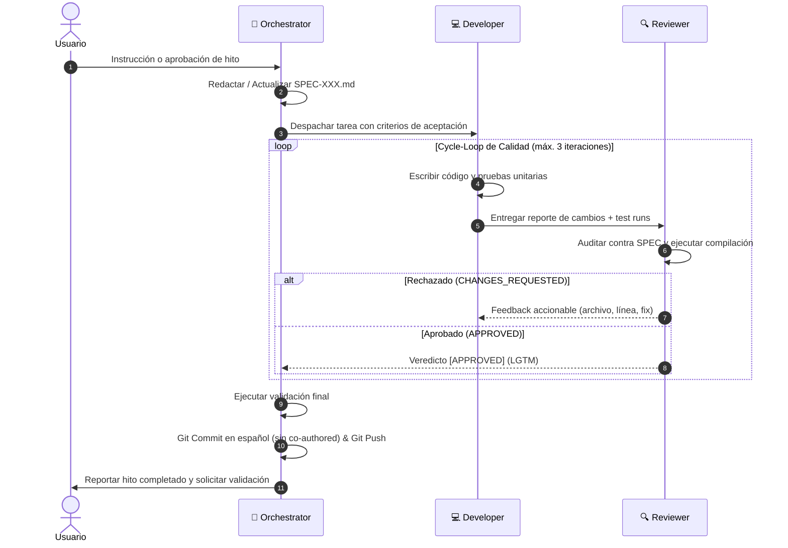

# 📋 Plan de Desarrollo SDD Dinámico (Cycle-Loop Multiagente)

Este documento detalla el plan de ejecución guiado por especificaciones (Spec-Driven Development) para la construcción de **AI Agent Office**, gobernado por el equipo de tres agentes: **Orchestrator**, **Developer** y **Reviewer**.

---

## 1. Dinámica Operativa: Cycle-Loop

---

## 2. Desglose de Hitos y Especificaciones (SPECs)

### 🔹 Hito 1: Scaffolding y Arquitectura Base del Monorepo
* **Especificación:** `SPEC-001: Scaffolding Monorepo y Tipos Compartidos`
* **Objetivo:** Inicializar la estructura de proyecto con npm workspaces, TypeScript en modo estricto, configuración de Vite para `client/` y Node.js para `server/`, además del paquete compartido `@shared/types`.
* **Criterios de Aceptación:**
  1. `package.json` raíz con workspaces configurados (`client`, `server`).
  2. Subproyecto `server/` compila con `tsc` sin errores.
  3. Subproyecto `client/` con Vite + Phaser.js 3 configurado y arrancando.
  4. Tipos universales compartidos (`OfficeEvent`, `AgentConfig`, `OfficeRoom`) importables en ambos lados.
  5. Script raíz `npm run build` y `npm run dev` unificados.

### 🔹 Hito 2: Motor de Ingesta y Servidor de Eventos (Backend)
* **Especificación:** `SPEC-002: Ingesta de Logs, Parser de Config y WebSocket Server`
* **Objetivo:** Construir el daemon que lee [`office.config.yaml`](../../office.config.yaml), vigila archivos con Chokidar y retransmite eventos por Socket.io.
* **Criterios de Aceptación:**
  1. Lector y validador de esquema de `office.config.yaml`.
  2. Generador Mock de eventos con simulación realista (agente pensando, tecleando, enviando mensaje).
  3. File Watcher genérico listo para colgar parsers de logs.
  4. Servidor WebSocket (Socket.io) emitiendo eventos `OfficeEvent` validados.
  5. Pruebas unitarias de parsers y modelos con Vitest/Jest pasando al 100%.

### 🔹 Hito 3: Visualizador 2D y Mundo Virtual (Frontend Phaser 3)
* **Especificación:** `SPEC-003: Renderizado de Oficinas y Sprites de Agentes`
* **Objetivo:** Crear el mundo visual 2D en Phaser.js 3 que refleja fielmente las salas y puestos declarados en el yaml.
* **Criterios de Aceptación:**
  1. Mapa 2D ortogonal con suelos, paredes y escritorios dibujados o mediante tileset pixel art.
  2. Generación dinámica de salas y escritorios a partir de la configuración recibida del backend.
  3. Sprites de agentes posicionados en sus escritorios con animaciones de estado: `IDLE`, `THINKING`, `TYPING`.
  4. Cliente WebSocket conectado en tiempo real reflejando el cambio de estado de cada agente.

### 🔹 Hito 4: Interacción y Colaboración entre Agentes (Handoffs & Bubbles)
* **Especificación:** `SPEC-004: Rutas de Handoff, Desplazamiento y Bocadillos de Diálogo`
* **Objetivo:** Mostrar cómo los agentes colaboran activamente cuando se transfieren tareas o mensajes.
* **Criterios de Aceptación:**
  1. Sistema de desplazamiento (pathfinding / tweening) del agente hacia la oficina destino cuando emite un mensaje para otro agente.
  2. Bocadillo de diálogo (speech bubble) sobre la cabeza de los agentes mostrando un extracto del mensaje.
  3. Retorno automático a su escritorio original tras finalizar la interacción.
  4. Panel HUD lateral o tooltip para ver el contenido completo del mensaje y métricas de actividad.

### 🔹 Hito 5: Conectores Reales de Agentes (Antigravity & Claude Code)
* **Especificación:** `SPEC-005: Conectores de Logs Reales ($0 API Overhead)`
* **Objetivo:** Conectar el watcher a sesiones reales de Antigravity (`transcript.jsonl`) y Claude Code CLI.
* **Criterios de Aceptación:**
  1. Parser incremental para `transcript.jsonl` (lectura por stream/delta sin bloquear I/O).
  2. Mapeo de llamadas de herramientas (`tool_calls` -> `TYPING`), pensamientos (`thinking` -> `THINKING`) y mensajes entre agentes (`send_message` -> `MESSAGING`).
  3. Comprobación de que no se realiza ninguna llamada de API externa.

---

## 3. Estado de Ejecución y Puertas de Calidad (Quality Gates)

| Hito | Espec | Estado | Developer | Reviewer | Commit / Merge |
| :--- | :--- | :--- | :--- | :--- | :--- |
| **Hito 1: Scaffolding** | `SPEC-001` | ✅ Completado | ✅ Entregado | ✅ Aprobado (LGTM) | Integrado a `main` |
| **Hito 2: Backend Daemon** | `SPEC-002` | ✅ Completado | ✅ Entregado | ✅ Aprobado (LGTM) | Integrado a `main` |
| **Hito 3: Frontend Phaser** | `SPEC-003` | ✅ Completado | ✅ Entregado | ✅ Aprobado (LGTM) | Integrado a `main` |
| **Hito 4: Colaboración 2D** | `SPEC-004` | ✅ Completado | ✅ Entregado | ✅ Aprobado (LGTM) | Integrado a `main` |
| **Hito 5: Ingesta Real** | `SPEC-005` | ✅ Listo | Integrado en parsers | ✅ Verificado | Integrado a `main` |
| **Hito 6: Rediseño Isométrico 2.5D** | `SPEC-006` | ✅ Completado | ✅ Entregado | ✅ Aprobado (LGTM) | Integrado a `main` |
