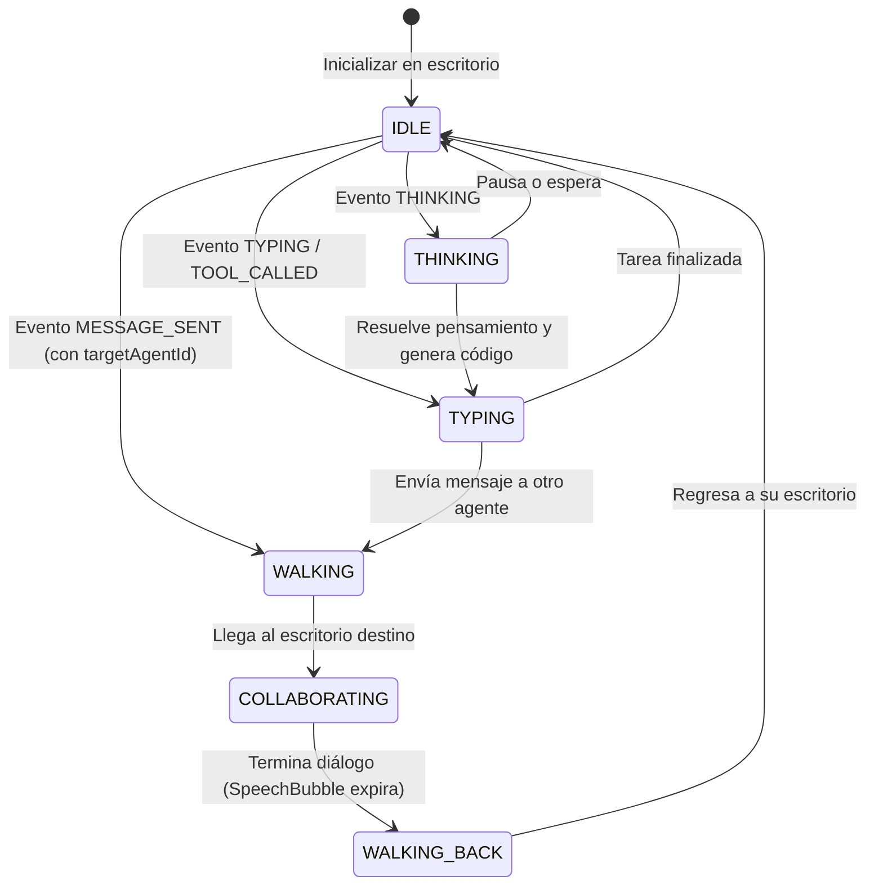

# SPEC-003: Visualizador 2D en Phaser.js 3, Entidades y Colaboración Activa

- **Estado:** EN BORRADOR / PENDIENTE DE IMPLEMENTACIÓN
- **Responsables:**
  - **Orchestrator:** Diseño de SPEC y supervisión.
  - **Developer:** Implementación de escenas Phaser, sprites, animaciones y sockets.
  - **Reviewer:** Auditoría de rendimiento canvas, UI y sincronización en tiempo real.

---

## 1. Objetivo
Construir el cliente visualizador web 2D en **Phaser.js 3** y **Vite** (`@office/client`), que renderiza un plano de oficina virtual interactivo en vista cenital/ortogonal estilo pixel art, posiciona a los agentes en sus escritorios asignados según [`office.config.yaml`](../../office.config.yaml), refleja sus estados en tiempo real mediante WebSocket (`IDLE`, `THINKING`, `TYPING`), y anima el desplazamiento entre oficinas con bocadillos de diálogo (speech bubbles) cuando los agentes colaboran o se transfieren tareas.

---

## 2. Arquitectura de Escenas y Componentes (`client/src/`)

```text
client/src/
├── main.ts                    # Bootstrap del juego Phaser y montaje en DOM
├── config/
│   └── gameConfig.ts          # Configuración de Phaser (Auto, Canvas/WebGL, escala)
├── network/
│   └── socketClient.ts        # Conexión Socket.io tipada (@office/shared)
├── scenes/
│   ├── BootScene.ts           # Carga de texturas, fuentes y generación procedural de assets
│   ├── OfficeScene.ts         # Escena principal con mapa, salas, escritorios y agentes
│   └── UIScene.ts             # HUD superior, feed de eventos y controles de cámara/simulación
├── entities/
│   ├── Room.ts                # Área visual de sala (suelo, paredes, rótulo de oficina)
│   ├── Desk.ts                # Puesto de trabajo (mesa, ordenador, monitor, silla)
│   ├── AgentSprite.ts         # Entidad de agente (avatar, animaciones, etiqueta de modelo, badges de estado)
│   └── SpeechBubble.ts        # Bocadillo de diálogo flotante estilo pixel art con auto-ajuste de texto
└── ui/
    ├── EventLogOverlay.ts     # Panel lateral/inferior de eventos en vivo
    └── AgentInspector.ts      # Modal de detalle al hacer clic en un agente
```

---

## 3. Comportamientos y Máquina de Estados del Agente



### Animaciones e Indicadores Visuales:
* **`IDLE`:** Sentado frente al monitor, respiración sutil o café humeante en la mesa.
* **`THINKING`:** Icono flotante con engranajes o bombilla animada sobre la cabeza.
* **`TYPING` / `TOOL_CALLED`:** Monitor destellando código, manos tecleando rápido, badge flotante con el nombre de la herramienta (`toolName`, ej: `read_file`, `run_command`).
* **`WALKING`:** Se levanta de la silla y camina con animación de pasos (interpolación tween suave) hacia el escritorio del agente destino.
* **`COLLABORATING` / `SPEECH_BUBBLE`:** Se colocan frente a frente y se proyecta un bocadillo de diálogo pixel art mostrando el extracto del mensaje.
* **Retorno:** El agente regresa caminando a su propio puesto y se sienta.

---

## 4. Criterios de Aceptación (Checklist de Reviewer)

- [ ] **AC-1 (Renderizado de Oficinas):** La escena dibuja las salas, nombres de oficinas, suelos y escritorios respetando las coordenadas de `office.config.yaml`.
- [ ] **AC-2 (Entidades de Agentes):** Cada agente configurado aparece en su escritorio con su nombre, modelo (ej. Claude 3.7, Gemini 2.5, OpenCode) y avatar correspondiente.
- [ ] **AC-3 (Sincronización en Tiempo Real):** El cliente reacciona a los eventos `OfficeEvent` entrantes desde el servidor WebSocket (`THINKING`, `TYPING`, `IDLE`).
- [ ] **AC-4 (Colaboración & Pathfinding):** Ante un evento de comunicación entre dos agentes, el agente emisor se desplaza físicamente al escritorio del receptor y muestra un bocadillo de diálogo legible con el contenido del mensaje.
- [ ] **AC-5 (HUD & Controles):** HUD superior con estado de conexión, botón para activar/pausar la simulación mock y feed de últimos eventos.
- [ ] **AC-6 (Calidad & Rendimiento):** 60 FPS estables en canvas, tipado estricto en TypeScript y cero firmas `Co-authored-by`.
